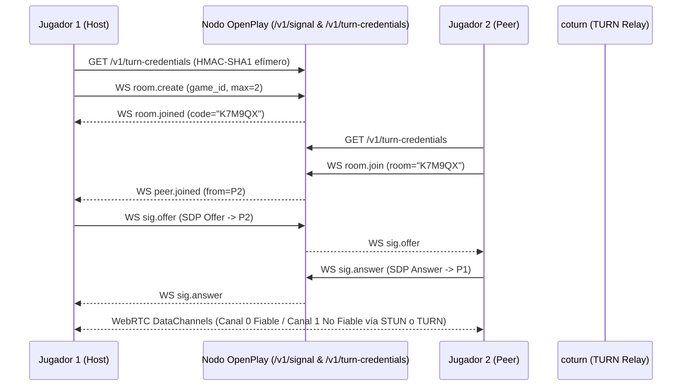

# OpenPlay — Arquitectura del Sistema (BETA)

OpenPlay es una plataforma **open-source (`Apache-2.0`) y federada** para descubrir, verificar y ejecutar videojuegos casuales/arcade deterministas en el navegador (PWA compatible con iOS Safari y Android Chrome), con multijugador P2P sobre WebRTC y modding opt-in seguro en Lua.

## 1. Vista General de Componentes

```mermaid
flowchart TD
    subgraph PWA["Cliente PWA (iOS Safari / Android Chrome / Desktop)"]
        UI["Shell Cyberpunk UI (Preact + Workbox)"]
        SW["Service Worker (Cache Offline SHA-256)"]
        RTC["Gestor P2P WebRTC (Lockstep / Rollback + Lab)"]
        subgraph Sandbox["Iframe Aislado (sandbox='allow-scripts', connect-src 'none')"]
            Host["Host ABI v0 Bridge"]
            Wasm["Módulo Core Wasm (Juego Determinista)"]
            ModWorker["Web Worker Lua Sandbox (Watchdog 2ms/tick)"]
        end
    end

    subgraph NodeA["Nodo Federado A (Go 1.23 + Postgres 16 + Redis 7)"]
        API["REST API (/v1/catalog, /v1/index.json, /v1/games)"]
        Sig["Servidor Señalización WS (/v1/signal)"]
        TurnGen["Generador HMAC-SHA1 TURN (/v1/turn-credentials)"]
        Crawler["Crawler Federado (ETag + Verificador JCS/Ed25519)"]
    end

    subgraph NodeB["Nodo Federado B (Peer Remoto)"]
        PeerIndex["/v1/index.json (Firmado Ed25519)"]
    end

    Coturn["Servidor TURN (coturn REST HMAC)"]

    UI <-->|HTTPS REST + Verificación Local Ed25519| API
    UI <-->|WSS Señalización SDP/ICE| Sig
    UI -->|postMessage estructurado| Host
    Host <-->|ABI v0 Memoria Lineal| Wasm
    Host <-->|Eventos Serializados| ModWorker
    RTC <-->|WebRTC DataChannels (0=Fiable, 1=No Fiable)| Coturn
    Crawler -->|GET /v1/index.json + If-None-Match| PeerIndex
```

## 2. Principios de Diseño

1. **Verificación Criptográfica de Extremo a Extremo (Zero-Trust en Nodos)**
   - Cada paquete de juego incluye un `manifest.json` firmado con **Ed25519** sobre `sha256(JCS(manifest_sin_signature))` conforme al **RFC 8785 (JSON Canonicalization Scheme)**.
   - Cada nodo federado publica `/v1/index.json` firmado con su propia llave Ed25519.
   - Tanto los nodos pares como la PWA del jugador verifican las firmas criptográficas y los hashes `SHA-256` antes de almacenar o instanciar un binario WebAssembly.

2. **Determinismo Estricto (`host-abi/0`)**
   - Los módulos WebAssembly **no tienen acceso a relojes del sistema (`Date.now`), entropía del sistema operativo ni red directa**.
   - El estado completo avanza únicamente mediante `game_init(seed, w, h)`, `game_input(kind, a, b, c)`, `game_net_recv(peer, ptr, len)` y `game_tick(dt_us)` a paso fijo (`1_000_000 / tickrate` microsegundos).
   - La serialización de estado mediante `game_snapshot` y `game_restore` permite **P2P Lockstep**, **Rollback Netcode** y verificación de sincronía mediante hashes periódicos de snapshot en el Laboratorio de Red (`packages/lab`).

3. **Aislamiento Multicapa para Juegos y Mods**
   - El runtime del juego corre dentro de un `<iframe sandbox="allow-scripts">` servido desde un origen aislado (`games.<domain>`) con política `Content-Security-Policy: default-src 'none'; script-src 'self' 'wasm-unsafe-eval'; img-src data: blob:; connect-src 'none'`.
   - Los mods en Lua son **100% opt-in**, declarados con metadatos SPDX, y se ejecutan en un **Web Worker dedicado** sin acceso al DOM ni a la red. Si un hook (`on_init`, `on_tick`, `on_event`) supera el presupuesto de **2 ms por tick** o **16 MiB**, el watchdog del host termina (`Worker.terminate()`) el worker de inmediato sin interrumpir la partida a 60 FPS.

## 3. Flujo de Señalización y Multijugador P2P


